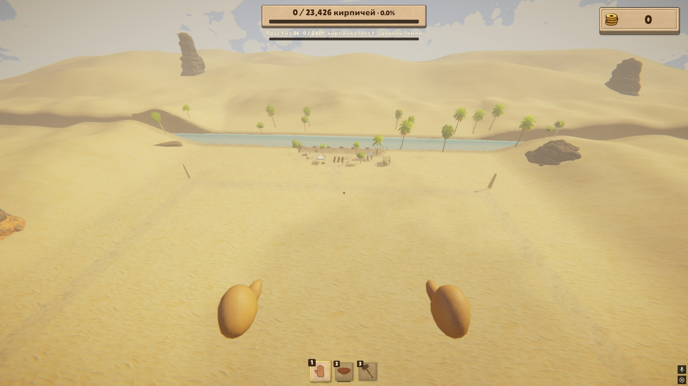
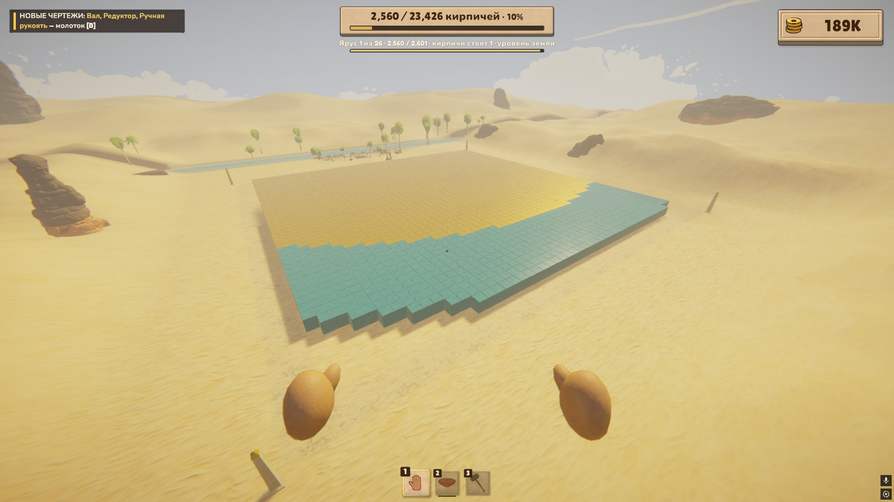

# 🏺 Piramid Helper
### A powerful mod for How They Built the Pyramids

A custom mod that expands gameplay with new abilities, powerful tools and configurable features.

## 🎮 Features

- 🚀 Enhanced player movement
- 🧱 Advanced brick controls
- 🏗️ Building unlock options
- 🎯 Trebuchet modifications
- ⚙️ Customizable settings
- 🔥 Additional gameplay enhancements

## 📸 Screenshots

Screenshots of the mod in action:

### Mod showcase

## 📦 Installation

Installing Piramid Helper is simple!

1. Download `PiramidHelper.dll`.
2. Open your game folder.
3. Open `BepInEx/plugins`.
4. Copy `PiramidHelper.dll` into this folder.
5. Launch the game!

That's it! Enjoy Piramid Helper! 🏺

**Note:** BepInEx 5 must already be installed.

---

**Enjoy Piramid Helper!** 🏺

## 👨‍💻 Developer

Created by **Spayr0**.

## 📜 License

See repository license information.
