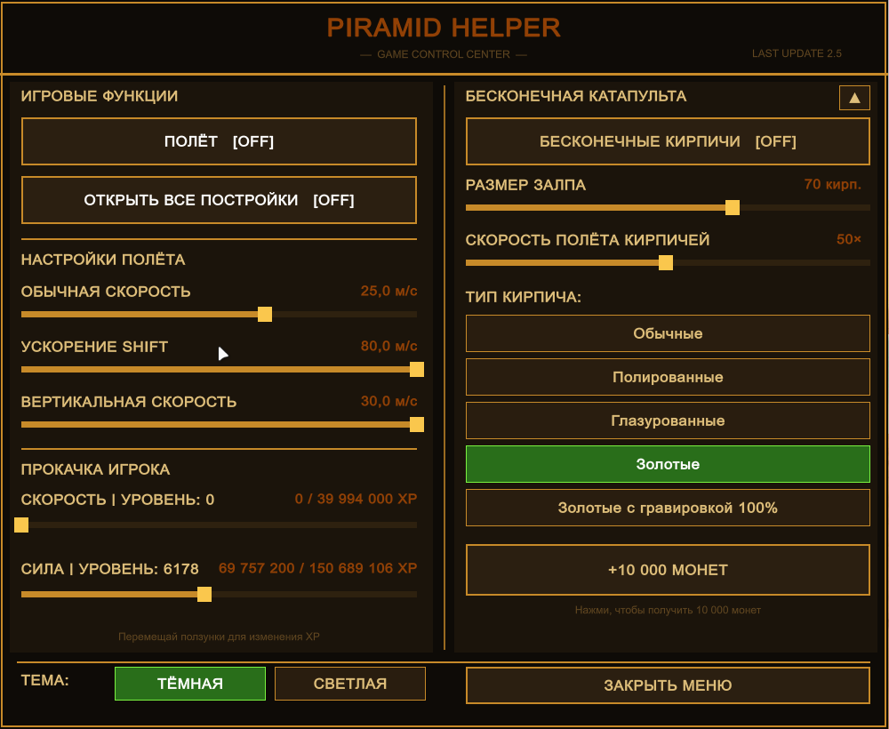
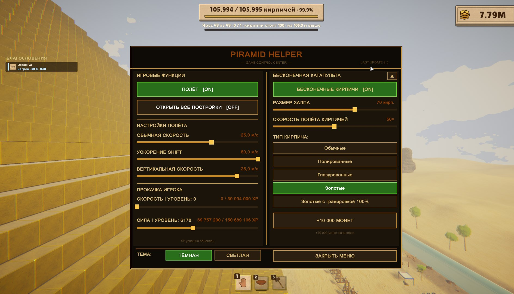
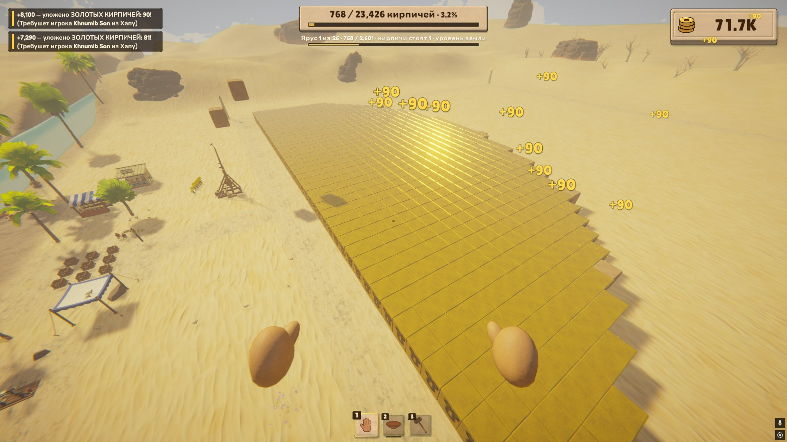

# 🏺 Piramid Helper
### A powerful mod for How They Built the Pyramids

A custom mod that expands gameplay with new abilities, powerful tools and configurable features.

## 🎮 Features

- 🚀 Enhanced player movement
- 🧱 Advanced brick controls
- 🏗️ Building unlock options
- 🎯 Trebuchet modifications
- ⚙️ Customizable settings
- 🔥 Additional gameplay enhancements

## 📸 Screenshots

Screenshots of the mod in action:

### Mod showcase

## 🛠️ Requirements

- How They Built the Pyramids
- BepInEx 5
- Compatible game version

## 📦 Installation

1. Install BepInEx 5.
2. Download the latest mod release.
3. Place the mod DLL into `BepInEx/plugins`.
4. Launch the game.

## 👨‍💻 Developer

Created by **Spayr0**.

## 📜 License

See repository license information.
